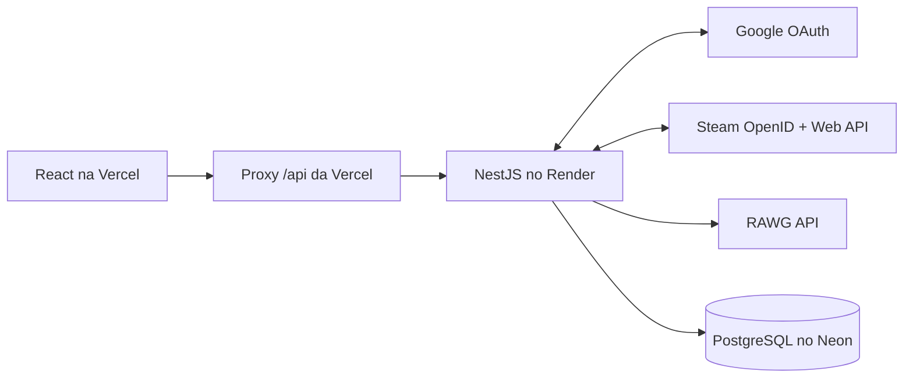
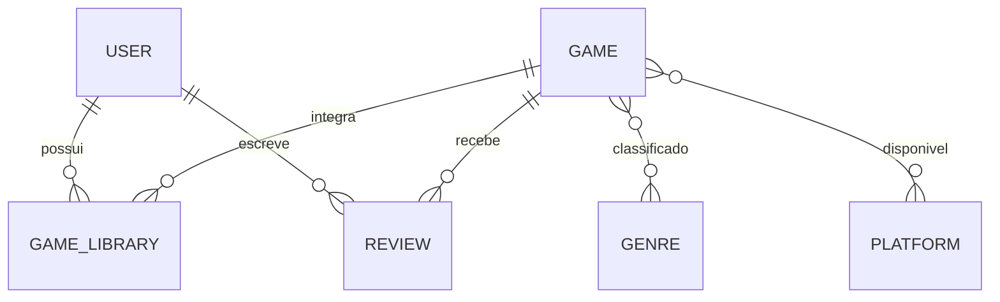

# GameTrack API

[](https://github.com/LucasCruz2773/game-tracker-api/actions/workflows/ci.yml)

API REST do **GameTrack**, uma aplicação para buscar jogos, organizar uma biblioteca pessoal, registrar progresso, publicar reviews e acompanhar estatísticas.

- Aplicação: https://game-tracker-web-two.vercel.app
- Health check: https://game-tracker-api-68q1.onrender.com/health
- Frontend: [LucasCruz2773/game-tracker-web](https://github.com/LucasCruz2773/game-tracker-web)

> A API utiliza uma instância gratuita do Render. A primeira requisição após um período de inatividade pode levar alguns segundos.

## Funcionalidades

- Autenticação com Google OAuth 2.0 e PKCE.
- Sessão JWT armazenada em cookie `httpOnly`.
- Busca e detalhes de jogos pelo catálogo RAWG.
- Vinculação da conta Steam por OpenID, com status e nota individuais na importação.
- Sincronização manual do tempo jogado sem reduzir valores registrados pelo usuário.
- Cache local dos jogos consultados.
- Biblioteca com edição direta de status, nota, horas jogadas e datas de progresso.
- Reviews com notas de 0,5 a 5 estrelas.
- Estatísticas agregadas para o dashboard.
- Paginação, filtros, ordenação e validação de entrada.
- Rate limiting, tratamento consistente de erros e health check.

## Stack

- Node.js 24, TypeScript e NestJS 12
- PostgreSQL e Prisma 7
- Google OAuth 2.0, JWT e cookies seguros
- Steam OpenID e Steam Web API
- Swagger/OpenAPI
- Vitest e Supertest
- Oxlint e Prettier
- Neon em produção e PostgreSQL via Docker no desenvolvimento
- Render para hospedagem

## Arquitetura



O navegador acessa a API por `/api` no mesmo domínio do frontend. A Vercel encaminha as requisições ao Render, mantendo o fluxo de cookies simples e evitando expor credenciais de serviços externos no cliente.

### Decisões técnicas

- A API é a única camada que conversa com RAWG e PostgreSQL.
- O primeiro login com Google cria o usuário automaticamente; não há senha local.
- A Steam é vinculada como integração; o Google continua sendo a identidade principal.
- O status não é inferido pela Steam: o usuário o escolhe para cada jogo ao importar, com `COMPLETED` como padrão.
- Jogos retornados pela RAWG são persistidos e seus detalhes são atualizados sob demanda.
- Restrições do banco impedem jogos duplicados na biblioteca e mais de uma review do mesmo usuário por jogo.
- O contrato HTTP é documentado com OpenAPI e tratado como fonte de verdade para o frontend.

## Modelo de dados



Entidades principais: `User`, `Game`, `GameLibrary`, `Review`, `Genre` e `Platform`. O schema completo está em [`prisma/schema.prisma`](./prisma/schema.prisma).

## Executando localmente

### Requisitos

- Node.js **24**
- Docker
- Chave da [RAWG API](https://rawg.io/apidocs)
- Cliente OAuth do tipo **Web application** no Google Cloud

### Instalação

```bash
cp .env.example .env
npm install
npm run db:up
npm run db:migrate
npm run start:dev
```

A API ficará disponível em `http://localhost:3000`:

- Swagger: `http://localhost:3000/docs`
- Health: `http://localhost:3000/health`

Configure no Google Cloud a URI de redirecionamento informada em `GOOGLE_CALLBACK_URL`. No ambiente local, o valor padrão é:

```text
http://localhost:3000/auth/google/callback
```

## Variáveis de ambiente

Use [`.env.example`](./.env.example) como referência. Não versione o arquivo `.env`.

| Variável                 | Finalidade                                      |
| ------------------------ | ----------------------------------------------- |
| `DATABASE_URL`           | Conexão PostgreSQL usada pela aplicação         |
| `DATABASE_URL_UNPOOLED`  | Conexão direta opcional para migrations no Neon |
| `TEST_DATABASE_URL`      | Banco descartável exclusivo dos testes E2E      |
| `JWT_SECRET`             | Assinatura dos tokens de sessão                 |
| `JWT_EXPIRES_IN_SECONDS` | Duração da sessão                               |
| `RAWG_API_KEY`           | Credencial do catálogo RAWG                     |
| `GOOGLE_CLIENT_ID`       | Identificador do cliente OAuth                  |
| `GOOGLE_CLIENT_SECRET`   | Segredo do cliente OAuth                        |
| `GOOGLE_CALLBACK_URL`    | Callback autorizado no Google Cloud             |
| `FRONTEND_URL`           | Destino do navegador após a autenticação        |
| `STEAM_WEB_API_KEY`      | Chave privada usada para consultar a Steam      |

## Endpoints principais

| Área    | Rotas                                                                                                                       |
| ------- | --------------------------------------------------------------------------------------------------------------------------- |
| Health  | `GET /health`                                                                                                               |
| Auth    | `GET /auth/google`, `GET /auth/google/callback`, `GET /auth/me`, `POST /auth/logout`                                        |
| Games   | `GET /games`, `GET /games/:id`                                                                                              |
| Library | `GET/POST /library`, `GET/PATCH/DELETE /library/:gameId`, `GET /library/stats`                                              |
| Reviews | `GET/POST /games/:gameId/reviews`, `GET .../reviews/mine`, `PATCH/DELETE /reviews/:id`                                      |
| Steam   | `GET /integrations/steam/connect`, `GET .../callback`, `GET/DELETE /integrations/steam`, `POST .../sync`, `POST .../import` |

Endpoints protegidos exigem o cookie de sessão `gametrack_session`. O Swagger fica habilitado apenas fora de produção.

## Qualidade e testes

```bash
npm run lint
npm test
npm run test:e2e
npm run build
```

- Testes unitários cobrem regras de domínio, autenticação, integração RAWG e tratamento de erros.
- Testes de integração exercitam autenticação, catálogo, biblioteca, reviews, Steam e health check contra um banco separado.
- `TEST_DATABASE_URL` é obrigatório e deve apontar para um banco cujo nome termine em `_test`; a suíte se recusa a limpar qualquer outro banco.
- O GitHub Actions executa lint, testes unitários e build em pushes para `main` e pull requests.

## Scripts úteis

| Comando                     | Descrição                                   |
| --------------------------- | ------------------------------------------- |
| `npm run start:dev`         | Inicia a API com hot reload                 |
| `npm run build`             | Gera o build de produção                    |
| `npm run start:prod`        | Executa `dist/main.js`                      |
| `npm run db:up` / `db:down` | Inicia ou encerra o PostgreSQL local        |
| `npm run db:migrate`        | Cria e aplica migrations em desenvolvimento |
| `npm run db:migrate:deploy` | Aplica migrations versionadas em produção   |
| `npm run db:studio`         | Abre o Prisma Studio                        |

## Deploy

- **API:** Render
- **Banco:** Neon, branch `production`
- **Frontend:** Vercel

O build de produção instala as dependências, compila a aplicação e aplica as migrations versionadas. Segredos permanecem nas variáveis de ambiente do Render; o Swagger é desabilitado quando `NODE_ENV=production`.

## Desenvolvimento full-stack

Este é um repositório independente. Para executar os testes integrados com o frontend, mantenha os clones como pastas irmãs:

```text
game-tracker/
├── game-tracker-api/
└── game-tracker-web/
```

Mudanças no contrato HTTP devem ser coordenadas entre os dois repositórios, preferencialmente com branches correspondentes e pull requests vinculados.
